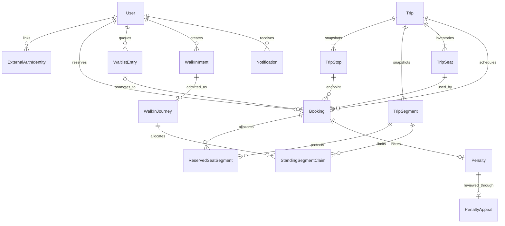
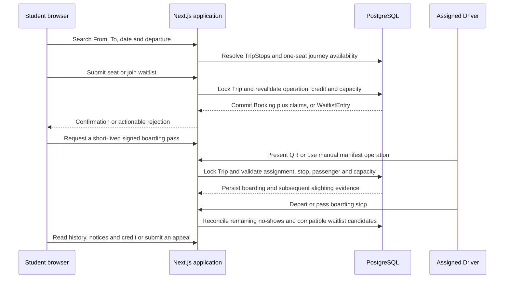

# Lee Jia Che — Passenger Reservation and Boarding Management Module

**Project:** TAR UMT Kuala Lumpur Campus Shuttle Management System
**Evidence context:** November 2026 Round 2 release review. See the [Round 2 engineering handoff](ROUND_2_FINAL_ACCEPTANCE.md) for executed checks, release status and limitations.

This individual report focuses on the passenger lifecycle within the common application. It consumes the directional routes, scheduled Trips, snapshotted topology and inventory, and actual stop progression provided by Wong Yun Hong's Fleet Operations and Live Tracking scope. References to the Driver and Admin interfaces describe the passenger-facing use cases. The scope records a reporting focus. Authorship claims require separate attribution evidence.

## Requirements traceability

| ID and requirement | Actors and use case | Design and evidence |
|---|---|---|
| P01 Institutional authorization | Student continues with Google, completes Student ID once, returns by stable provider subject and signs out | `ExternalAuthIdentity` + signed onboarding cookie + DB-revalidated session. Identity claim, expiry, concurrent linkage, privileged conflict and logout suites. Real GIS acceptance pending. |
| P02 Search and availability | Student selects From, To, service date, departure and a journey-specific numbered seat | `TripStop` endpoints identify `TripSegment` interval; MYT service dates; browser core-flow/mobile and journey/ETA suites. |
| P03 Reserve and cancel | Student submits seat, reads confirmation or conflict, views own history and cancels an eligible reservation | One `TripSeat` on every required segment. `Booking` and `ReservedSeatSegment`. Phase 4 integration and booking browser case. |
| P04 Waitlist | Student joins when no compatible seat spans the journey. Eligible cancellation releases claims and promotes the oldest compatible entry | Transactional `WaitlistEntry`, oldest compatible order, unchanged priority for skipped entries. Phase 4 and browser waitlist case. |
| P05 Walk-in | Student creates intent and presents pass. Driver admits only if all standing segments have space | `WalkInIntent` creates zero capacity claims. Admission creates `WalkInJourney` and `StandingSegmentClaim` atomically. Phase 5 integration and walk-in browser case. |
| P06 Boarding and alighting | Assigned Driver reads manifest, scans short-lived pass or uses manual controls, then records alighting and stop progress | Purpose-specific signed pass and common server rules, durable state and check-in method. Phase 5 integration and manual boarding browser case. Camera hardware pending. |
| P07 No-show, credit and appeal | Student views outcome and credit, submits appeal. Admin resolves once | Actual stop progress gates no-show. One `Penalty` per booking and one `PenaltyAppeal` per penalty. Phase 6 integration and browser appeal case. |
| P08 History, notifications and analytics | Student reads own booked and walk-in history and notices. Admin reads passenger aggregate metrics | Authoritative projections; unaffiliated passengers cannot inspect another student's reservation. Specification, topology/booking, operations analytics and projection tests. |
| P09 Live tracking integration | Student reads latest shuttle position and provenance | Trip tracking consumes Wong scope's persisted simulated telemetry and refetches over HTTP after realtime invalidation. Phase 8 and independent Chromium clients. |

## Passenger data relationships

See the [full ERD](FINAL_ERD.md), [passenger sequences](FINAL_PASSENGER_SEQUENCES.md) and [fleet sequences](FINAL_FLEET_SEQUENCES.md).

## Reservation and operating sequence

In an A → B → C Trip, A → C needs one common physical seat across A–B and B–C. A → B and B → C may reuse the same seat. The PostgreSQL per-seat/per-segment unique key protects the interval. On cancellation, the transaction removes released claims, evaluates waiting entries in order, skips incompatible journeys and promotes an eligible one without resetting the skipped entries' priority. Walk-in standing admission applies the Trip's standing snapshot to each requested segment while holding the Trip row lock, so concurrent final-slot requests cannot both win.

Trip progression and boarding share the authoritative lock. App-level checks run inside the transaction with database constraints as protection against overlapping claims. Fleet scheduling owns the separate resource-lock order described in the [concurrency evidence](FINAL_CONCURRENCY_EVIDENCE.md). Student browsing and realtime signals are projections of durable state.

## Authentication, proof and consequences

- Google verifies signature, issuer, audience and expiry. The app additionally requires a verified canonical Student email and the approved Workspace `hd` claim. It binds Google `sub` through a unique provider identifier, creates the first account in a transaction and refuses conflicting subject/email mappings and privileged accounts.
- A role/version-revalidated HttpOnly cookie protects passenger APIs. Object authorization is checked against the signed-in passenger or assigned Driver subject. Staff password reset and application signing use their own controls.
- Reserved QR proves a reservation lookup and Walk-in QR proves an intent lookup. Expiry and signature are checked before the server revalidates Trip, actor, boarding stop and current state. Manual operation invokes the same durable rules and records its method.
- Reservations open seven days before the service day under the canonical policy. Closure and no-show rely on actual boarding-stop progress. Timetable delay alone never creates a penalty. Initial credit is 100, a reserved no-show deducts up to 15 and reservations are restricted below 40. Resolution restores the recorded deduction once, capped by the credit policy. Record existing departure-reminder ambiguity as open scope.

## Chapter and viva material

**Chapter 3. Requirements and analysis.** Explain the observed campus queue process and distinguish proposed prototype changes. Cover actors, scope, P01–P09 requirements, normal/exceptional use cases, feasibility, constraints and the Fleet integration contract. Cite actual assets and verified project sources where the report template calls for references.

**Chapter 4. System design.** Draw the passenger ERD and sequences, describe endpoint and segment derivation, give a seat-reuse example, expand FIFO compatibility and standee transactions, explain QR/manual validation, the no-show/appeal state changes and the database concurrency tests. Describe the one application/runtime architecture and label simulated GPS.

| Demonstration | Expected visible result |
|---|---|
| Reserve on a seeded journey | Numbered seat, confirmed journey, own Reserved Pass and relevant manifest row |
| Full Trip waitlist and cancellation | WAITING where no compatible seat exists, promotion only when a compatible seat is released |
| Walk-in and reserved boarding | Non-guaranteed intent language, server-authorized standing admission or FULL; reserved boarding records exactly once |
| Operational no-show and appeal | Visible no-show, credit deduction and one restoration after an accepted appeal |
| Realtime and recovery | Simulated GPS provenance, transport interruption and authoritative HTTP retrieval |
| Institution/device acceptance | Controlled staging GIS sign-in and real camera result require operator evidence |

Browser fixtures are synthetic. The report may cite authenticated fixture flows, test results and the synthetic PostgreSQL 17 rehearsal. Formal accessibility certification, actual institutional provider login, shared rollout, physical-device QR validation and production deployment remain pending.
